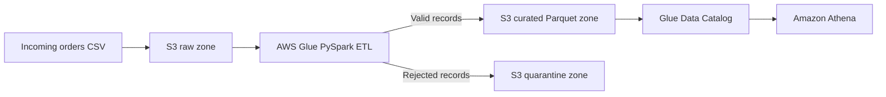

# Serverless AWS Data Lake: Orders ETL Pipeline

A portfolio project demonstrating a batch data-engineering workflow on AWS using Amazon S3, AWS Glue (PySpark), AWS Glue Data Catalog, and Amazon Athena.

> **Project status:** Source code and deployment guide are committed. Run it in an AWS account and add your own execution screenshots, job-run details, and Athena query results before presenting it as a deployed production implementation.

## 1. Business scenario

An online retailer receives daily order CSV files. Analytics users need clean, deduplicated, query-ready data without querying raw files directly.

## 2. Architecture



## 3. AWS services

- **Amazon S3:** raw, curated, and quarantine storage zones.
- **AWS Glue job:** schema enforcement, validation, deduplication, transformation, and Parquet output.
- **AWS Glue Data Catalog:** table metadata for the curated dataset.
- **Amazon Athena:** serverless SQL analytics over curated Parquet files.
- **AWS IAM / CloudWatch:** least-privilege execution permissions and job logs.

## 4. Repository structure

```text
aws-serverless-data-lake/
├── README.md
├── glue_jobs/
│   └── transform_orders.py
├── sample_data/
│   └── orders.csv
└── sql/
    └── quality_checks.sql
```

## 5. Input schema

| Column | Type | Rule |
|---|---|---|
| order_id | string | Required; unique after deduplication |
| customer_id | string | Required |
| order_ts | timestamp text | Must parse as a timestamp |
| amount | decimal text | Must be non-negative |
| currency | string | Required |

The sample file is synthetic and contains no real customer information.

## 6. Deploy and run

1. Create three S3 prefixes or buckets for raw, curated, and quarantine data. Keep public access blocked.
2. Upload `sample_data/orders.csv` to the raw prefix, for example `s3://YOUR_BUCKET/raw/orders/`.
3. Create an AWS Glue IAM role with only the S3 access and Glue/CloudWatch permissions required for this job. Do not use broad administrator permissions.
4. Create a Glue Spark job and upload `glue_jobs/transform_orders.py` as its script.
5. Set job parameters:
   - `--SOURCE_PATH s3://YOUR_BUCKET/raw/orders/`
   - `--TARGET_PATH s3://YOUR_BUCKET/curated/orders/`
   - `--QUARANTINE_PATH s3://YOUR_BUCKET/quarantine/orders/`
6. Run the job and inspect its CloudWatch logs and output object counts.
7. Create or update a Glue Data Catalog table for the curated Parquet output. A crawler can infer the partitioned schema, or define the table explicitly.
8. Run the queries in `sql/quality_checks.sql` in Athena after replacing the example database/table names.

## 7. Transformation logic

- Reads CSV input with a header.
- Applies an explicit schema and parses timestamps and amounts.
- Sends rows with missing required values, invalid timestamps, or negative amounts to quarantine.
- Deduplicates valid rows by `order_id`, keeping the latest event timestamp.
- Writes curated data as Parquet, partitioned by order year, month, and day.

## 8. Validation checklist

- [ ] Glue job completes successfully.
- [ ] Source row count = valid row count + rejected row count (before deduplication).
- [ ] Curated `order_id` values are unique.
- [ ] No null required fields exist in curated data.
- [ ] No negative amounts exist in curated data.
- [ ] Athena can query the curated table and partitions.
- [ ] CloudWatch logs show no unhandled errors.

## 9. Cost and security considerations

AWS services may incur charges. Use a small sample dataset, choose the smallest suitable Glue worker configuration, avoid unnecessary repeated runs, and delete test resources after validation. Configure S3 Block Public Access, encryption, and least-privilege IAM. Never commit credentials, account IDs, private data, or secrets.

## 10. Evidence to add after your own AWS run

Add sanitized screenshots or notes for the Glue job success, CloudWatch run logs, S3 curated/quarantine outputs, and Athena query results. Do not claim production deployment, performance numbers, or cost savings until measured.

## Skills demonstrated

AWS S3 · AWS Glue · PySpark · AWS Glue Data Catalog · Amazon Athena · SQL · Data Quality · ETL · Parquet · Data Lake Design · IAM · CloudWatch
