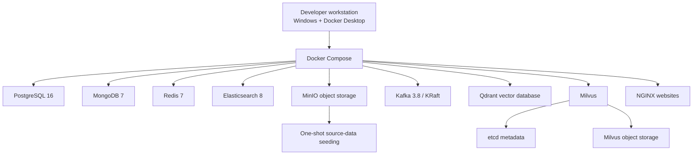

# Tinitiate Technologies – Multi-Service AI & Data Engineering Environment

A hands-on project documenting the setup, operation, and troubleshooting of a Docker Compose-based local development environment used for AI and data engineering workflows.

> **Attribution and scope:** This portfolio case study records my environment setup and validation work in the Tinitiate Technologies context. The upstream onboarding stack and its original Compose definitions belong to Tinitiate. This repository does not claim authorship of that platform or imply that this local development stack is a production deployment.

## Project overview

The environment brings several data and AI infrastructure components together so developers can work with relational, document, cache, search, object-storage, streaming, and vector database services on a local Windows/Docker Desktop machine.

## Architecture



## Technology components

| Component | Technology | Purpose |
|---|---|---|
| Relational database | PostgreSQL 16 | Structured application and analytics data |
| Document database | MongoDB 7 | JSON/document-oriented data |
| Cache | Redis 7 | In-memory caching and key-value operations |
| Search engine | Elasticsearch 8.15 | Full-text search and indexing |
| Object storage | MinIO | S3-compatible object storage |
| Streaming | Apache Kafka 3.8 (KRaft) | Event streaming and messaging |
| Vector database | Qdrant | Vector similarity search |
| Vector database | Milvus 2.4 | Vector storage and retrieval |
| Metadata store | etcd | Milvus metadata coordination |
| Web server | NGINX | Serves local sample websites and policy documents |
| Environment management | Docker Compose | Service lifecycle, networking, volumes and configuration |

## My hands-on work

- Prepared the Windows development workspace and Docker Desktop environment.
- Used Docker Compose to start selected services and the required multi-service stack.
- Inspected running containers, service status, port mappings, and container logs.
- Validated service reachability, including the MinIO HTTP health endpoint.
- Worked through an image-pull authorization issue affecting the MinIO image and tested an alternative S3-compatible storage image for the local environment.
- Reviewed persistent Docker volumes and the effect of stopping containers versus removing volumes.
- Checked host-port conflicts and adjusted service port mappings where needed.
- Practiced connecting to database and infrastructure services using their local endpoints.

## Operational commands

Run these commands from the upstream project directory. Use the Compose filename supplied by that project.

```powershell
# Start the environment
docker compose -f tinitiate-ai-onboarding.yml up -d

# Check containers and health
docker compose -f tinitiate-ai-onboarding.yml ps

# Follow logs for an individual service
docker compose -f tinitiate-ai-onboarding.yml logs -f postgres

# Check MinIO liveness
Invoke-WebRequest http://localhost:9002/minio/health/live

# Stop containers while retaining named volumes
docker compose -f tinitiate-ai-onboarding.yml down
```

To start only selected services, list their service names after `up -d`. Confirm dependencies and health before using dependent services.

## Validation checklist

- [ ] Docker Engine is running.
- [ ] Compose configuration parses successfully.
- [ ] Expected containers are running.
- [ ] Database services report healthy where health checks are configured.
- [ ] Host ports are mapped as expected and are not conflicting.
- [ ] MinIO liveness endpoint responds successfully.
- [ ] Kafka, Qdrant, and Milvus endpoints are reachable.
- [ ] Persistent volumes remain after a normal `down`.
- [ ] Logs have been reviewed for startup or runtime errors.

Only mark checks complete after running them in your own environment. Do not publish credentials, tokens, private data, or unredacted environment files.

## Key engineering practices demonstrated

- Multi-container orchestration with Docker Compose
- Local infrastructure provisioning and service dependency awareness
- Database and middleware connectivity troubleshooting
- Port mapping and container networking
- Health checks, logs, and operational validation
- Persistent storage and volume lifecycle management
- S3-compatible object storage
- Streaming and vector database infrastructure

## Upstream project reference

- [Tinitiate AI Setup – upstream repository](https://github.com/venkata-bcs/tinitiate-ai-setup)
- [Tinitiate Onboarding Installer](https://github.com/tinitiateprime/tinitiate-onboarding-installer)

## Portfolio evidence to add

Add sanitized screenshots of your own Docker Compose status, successful service health checks, MinIO health response, and troubleshooting results. Do not imply that screenshots or metrics exist until you have captured them.

## Environment classification

**Local development / learning environment.** This is not evidence of a highly available production deployment, production scale, or measured performance benchmarks.
